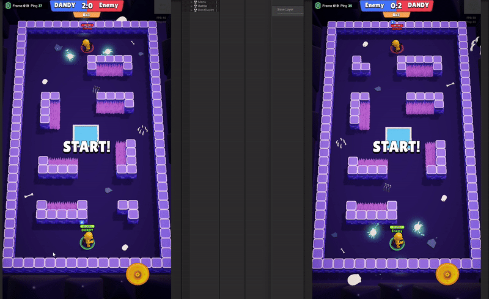

# Duel Archers — deterministic 1v1 PvP (Photon Quantum 3)

Real-time PvP archery prototype built with Unity and **Photon Quantum 3**.
Gameplay runs in Quantum's deterministic ECS simulation; menus and UI are classic OOP on top of it.

⬇️ Real-time **duel between archers** ⬇️



## 🎯 Features

- 🔁 **Deterministic multiplayer simulation** via Photon Quantum (rollback, input-based sync)
- 🧠 **Custom matchmaking system** with configurable room parameters
- 🤖 **Bot opponent mode** to test mechanics without another player
- 🏹 **Archero-like controls** — auto-attack while moving/stopping
- 🧪 **Ability deck selection & combination** in the menu before the match
- 🔥 **Stackable ability effects** — e.g., fire + poison arrows, orbiting weapons
- 🌿 **Bush stealth system** inspired by Brawl Stars — attacking reveals your position
- 🕹 **Game state flow**: match intro → countdown → gameplay → round end → reset → game over
- ♻️ **Rounds system** supporting Bo1, Bo3, Bo5 formats
- ⚙️ **Hybrid architecture**: ECS for gameplay logic, OOP for UI/menu systems

## 🛠 Tech stack

Unity · C# · Photon Quantum 3 · Zenject · DOTween

## 🧱 Architecture

```
QuantumUser/Simulation/   deterministic gameplay (Quantum ECS)
  Gameplay/Features/      Movement, Armaments, CharacterStats, Cooldowns,
                          Effects, Lifetime, GameplayStates
Code/                     Unity-side (OOP)
  Infrastructure/         DI installers, loading, game state machine
  Online/                 connection, matchmaking, rooms, simulation start
  Player/                 view, camera, input event handlers
  UI/                     menu, match intro, countdown, score, game over
```

- **Simulation and view are separated:** all gameplay state lives in the deterministic Quantum frame; Unity only reads it and renders.
- **Feature-based ECS:** each feature has its own components (`.qtn`) and systems.
- **Game state machine + DI** drive the flow from boot → menu → matchmaking → match.
